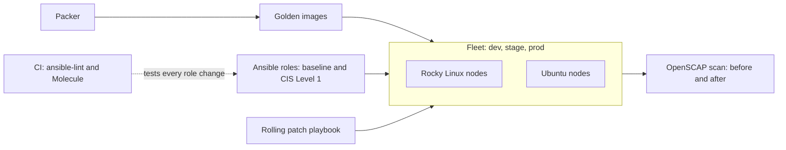

# FleetForge

A pipeline that builds identical, hardened Linux servers and patches them in small, health-checked batches, without anyone staying up all night.

> **Status:** Phase 0 (repository foundation) in progress. Every number in this repository is either a target or a measured result with a link to its evidence. Nothing is claimed until it is measured.

## The problem

Linux servers rarely stay alike. Three problems build up over time:

- **Drift.** Each server was built slightly differently, so nobody knows what is on any of them.
- **Unmeasured security baseline.** The CIS benchmark score (a standard hardening checklist) is never measured. These are the findings audits and penetration tests flag first.
- **Manual patch night.** Updates run as a loop of SSH logins that reboots everything at once, and sometimes takes production down.

FleetForge builds servers from one tested image, enforces the baseline with code, and patches through a pipeline that proceeds slowly, checks health, and stops itself when something looks wrong.

## Architecture



| Layer | Tool | Role |
|---|---|---|
| Image build | Packer | Builds a hardened golden image for each OS family |
| Configuration | Ansible roles, dynamic inventory by environment and role | Applies the baseline and CIS Level 1 settings; safe to re-run (idempotent) |
| Compliance | OpenSCAP with CIS Level 1 profiles | Scores each host before and after hardening |
| Patching | Ansible `serial`, health checks | Canary first, then rolling batches; halts on a failed check; reboots only when the kernel changed |
| Testing and CI | ansible-lint, Molecule, GitLab CE, Jenkinsfile | Tests every role change before it reaches the fleet |
| Lab | VirtualBox virtual machines (see [decision 0005](decisions/0005-lab-platform-virtualbox.md)) | Six VMs, mixed OS families |

## Design decisions

| Decision | Reason |
|---|---|
| Packer golden images | Every server starts from the same known-good base, so a lost server is rebuilt in minutes. Both RHEL-family and Ubuntu images are built, because real fleets are mixed. |
| Ansible roles | Baseline (users, sudo, SSH hardening, time sync, auditd, SELinux enforcing), CIS Level 1 fixes, disk layout, log forwarding and monitoring each get their own role, so each is small and testable. |
| SELinux kept enforcing | Denials are diagnosed instead of switching SELinux off, which keeps a key protection on. |
| Dynamic inventory by environment and role | Playbooks target groups such as "prod web servers" instead of hand-maintained lists, so new servers are picked up automatically. |
| Canary, then rolling batches | A bad update reaches a small share of servers, not all of them. Ansible's `serial` sets the batch size. |
| Health checks and auto-halt | Each batch is checked before and after patching. A failed check stops the run, so a problem stays small. |
| Reboot only if the kernel changed | Avoids needless downtime, because most updates do not need a restart. |
| OpenSCAP before and after | Makes the security improvement a number in a report instead of a claim. |
| Molecule and ansible-lint in CI | Roles are tested like software, so a broken change is caught in minutes, not on a production server. |
| GitLab CI plus a Jenkinsfile | Shows the same pipeline on two common CI tools. |
| Push (Ansible) rather than pull (Puppet, Chef) | Needs no agent and runs when the operator chooses, which suits ordered rollouts. Trade-off: servers do not self-correct between runs. |

Lab-level decisions are recorded in [decisions/](decisions/README.md).

## Targets and results

| Goal | Target | Measured | Evidence |
|---|---|---|---|
| CIS Level 1 score, Rocky Linux, before hardening | Measure only | pending | - |
| CIS Level 1 score, Rocky Linux, after hardening | 92% or higher | pending | - |
| CIS Level 1 score, Ubuntu, before hardening | Measure only | pending | - |
| CIS Level 1 score, Ubuntu, after hardening | 92% or higher | pending | - |
| Ansible roles, each with Molecule tests | 8 | pending | - |
| Patch run unattended, with canary and rolling batches | Completes without manual steps | pending | - |
| Reboots that take every host down at once | 0 | pending | - |
| New server from golden image to compliant | Under 10 minutes | pending | - |

Scores are reported per OS family because the benchmark content differs between them. The design document's pre-hardening estimate of about 55% is an estimate and is not reported as a result.

## Lab notes

The lab runs on one Windows 11 laptop (AMD Ryzen 9 8945HX, 15.3 GB RAM, one SSD). The fleet is six virtual machines, so canary and batch sizes are demonstrated at that scale. Versions are the latest stable releases at the time each component is installed ([decision 0003](decisions/0003-version-policy.md)); each evidence entry records the versions used and the date.

## Roadmap

| Phase | Scope | Gate | Status |
|---|---|---|---|
| 0 | Repository foundation | Repository pushed; secret scrub check passed; remote head equals local head | In progress |
| 1 | Lab VMs and inventory | Every VM answers `ansible -m ping` by group; dynamic inventory returns environment and role groups; idle memory per OS measured | Not started |
| 2 | Baseline roles | Baseline applied to the whole fleet; a second run reports `changed=0`; SELinux enforcing on RHEL-family hosts | Not started |
| 3 | OpenSCAP and CIS Level 1 | Before and after scans recorded per OS with reports saved | Not started |
| 4 | Rolling patch playbook | Canary then batches run; a forced failure halts the run; reboot happens only when the kernel changed | Not started |
| 5 | Molecule and ansible-lint | Every role has a passing Molecule scenario including the idempotence check | Not started |
| 6 | Packer golden images | Image builds; time from image to compliant server measured | Not started |
| 7 | GitLab CI and Jenkinsfile | A deliberately broken role fails the pipeline; the fixed role passes | Not started |
| 8 | Closeout | README results table filled only from recorded measurements | Not started |

## Repository layout

```
README.md       status, architecture, targets and results, roadmap
decisions/      numbered decision records and an index
evidence/       one folder per phase: dated test runs and measurements
```

Folders for roles, playbooks, inventory, lab scripts and documentation are added in the phase that first needs them.
